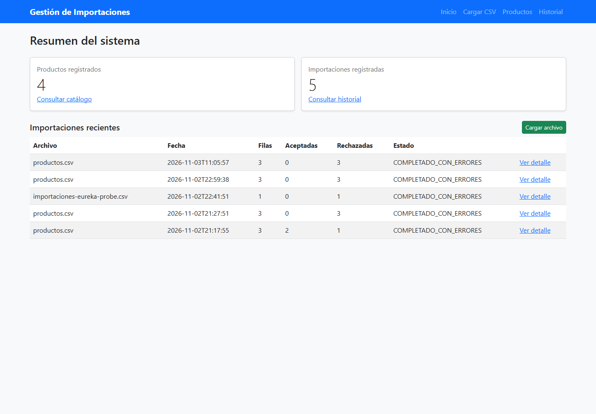
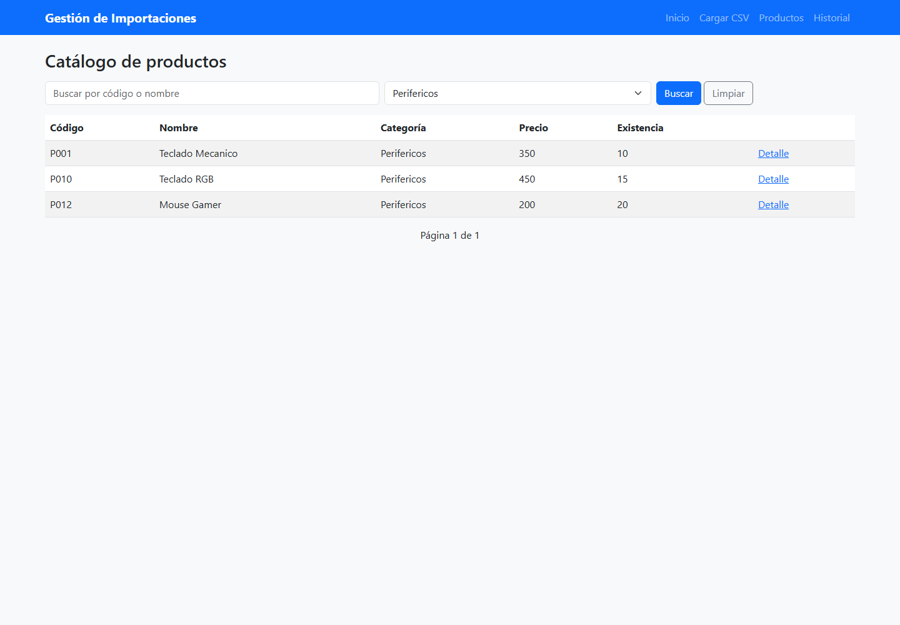
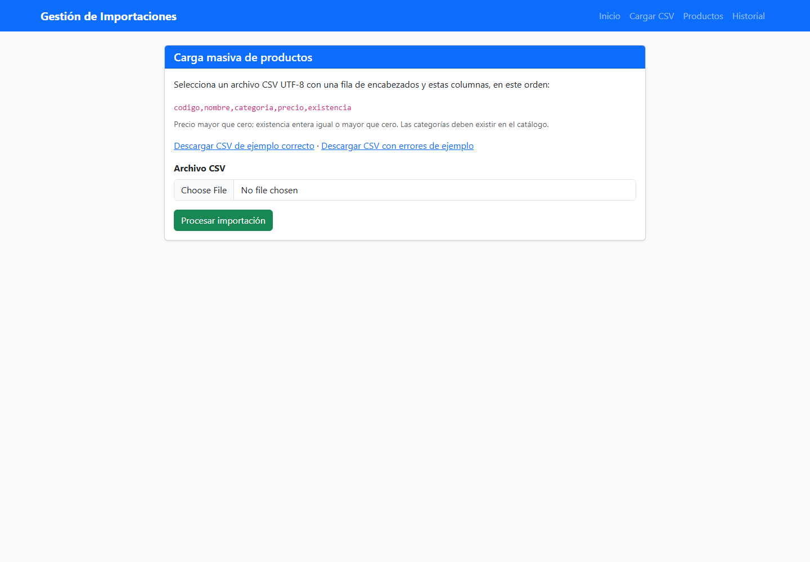
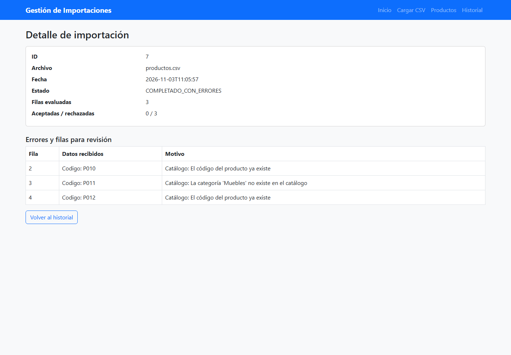

# Evidencia funcional

Capturas tomadas de la aplicación ejecutándose en XAMPP, conectada al API Gateway, los microservicios Spring Boot y las bases MySQL existentes.

## Resumen e historial reciente

## Consulta del catálogo por categoría

## Carga de CSV

## Importación con filas rechazadas

